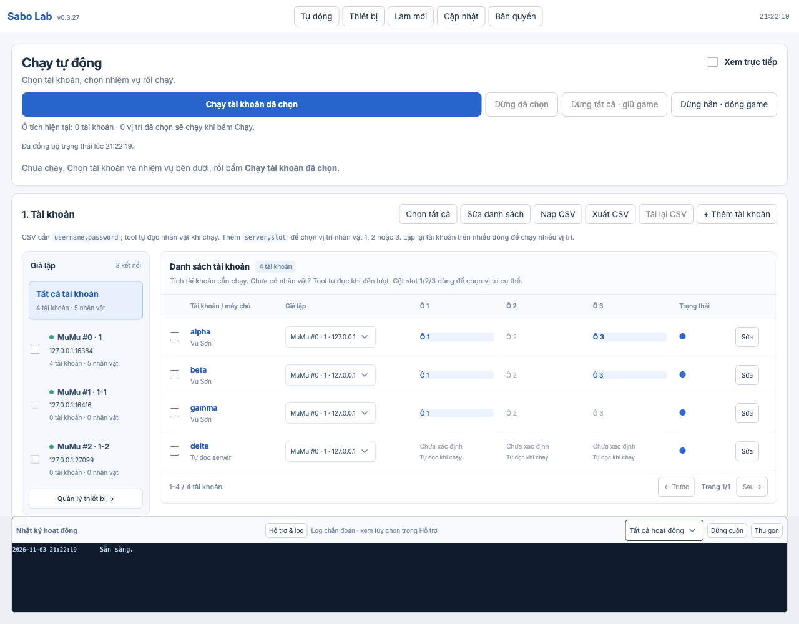
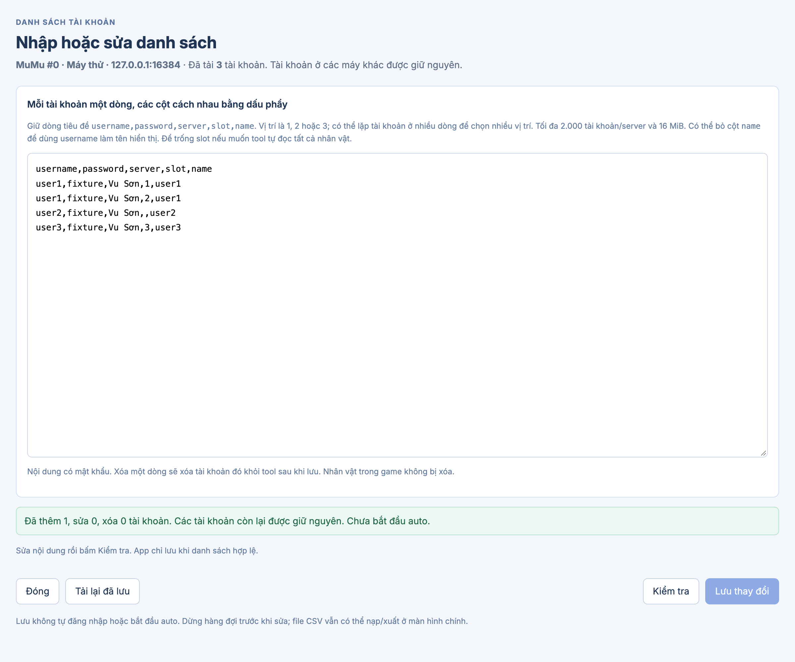
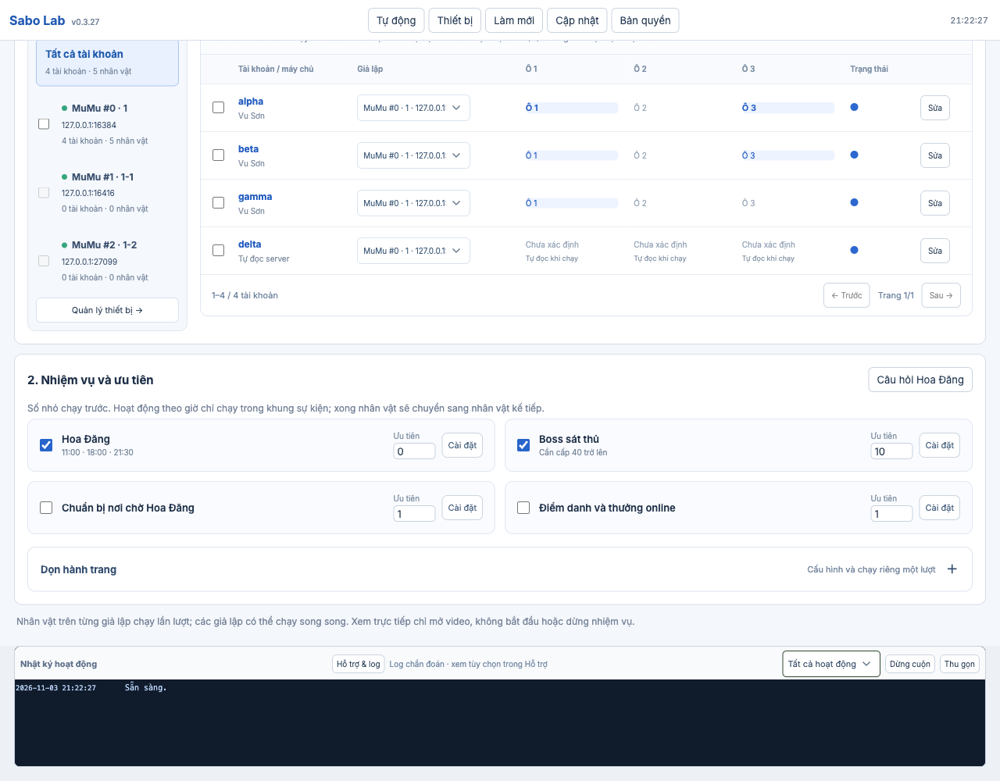
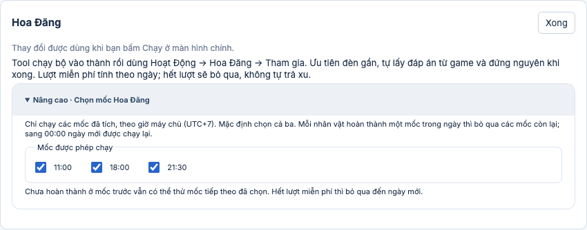
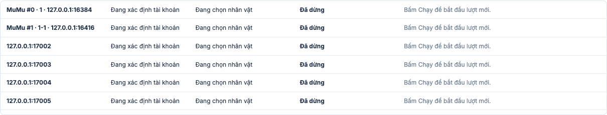
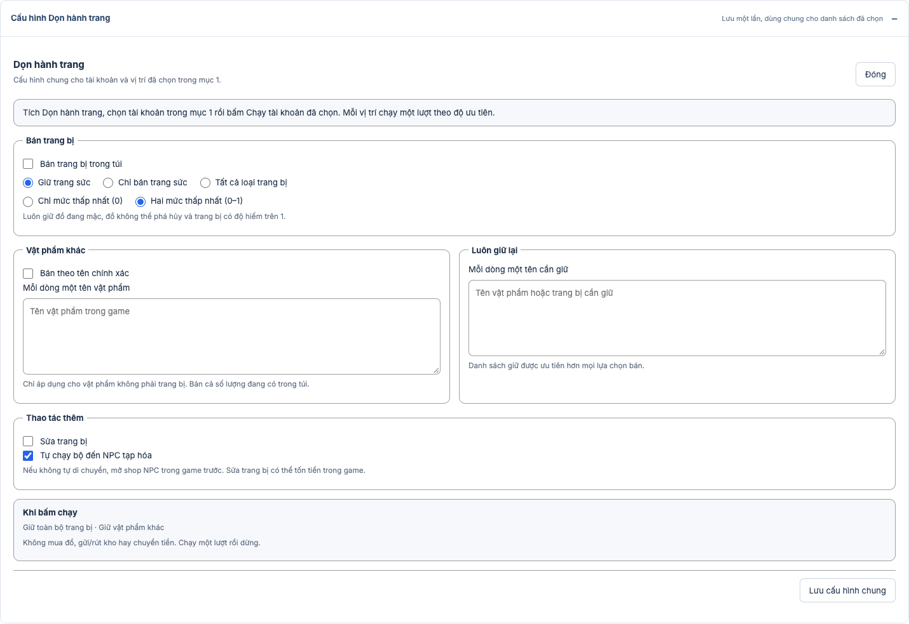
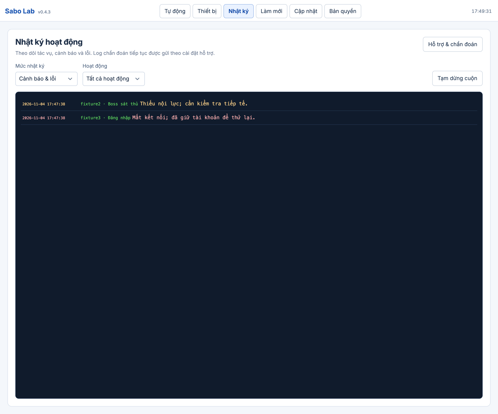
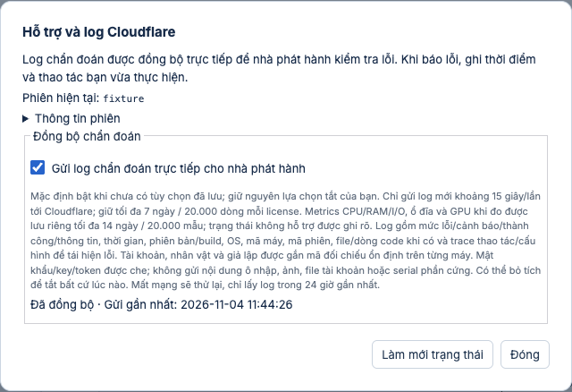

# Dùng Sabo Lab

Hướng dẫn UI **0.4.4**. [Tải bản mới nhất](https://github.com/MinhOmega/sabo-lab-build/releases/latest) hoặc dùng **Cập nhật** trong app.

Ảnh dưới dùng tài khoản minh họa và IPC mô phỏng, không phải kết quả chạy game thật.

## Kết nối và nhập tài khoản

Mở MuMu và các cửa sổ Android cần dùng. Vào **Thiết bị**, bấm **Tìm MuMu đang mở** nếu chưa thấy máy. Mỗi cửa sổ MuMu là một giả lập riêng, có địa chỉ ADB riêng. Trở lại **Tự động**.



Chọn một giả lập ở cột trái, bấm **Sửa danh sách**, dán danh sách rồi **Kiểm tra → Lưu thay đổi**. Dùng bốn cột; để trống server/slot nếu muốn tool tự đọc:

```csv
username,password,server,slot
account01,fixture-only,,
account02,fixture-only,,
```

Tool sẽ tự đọc nhân vật khi từng tài khoản đến lượt. Nếu có nhiều server, thêm `server` để chọn đúng nơi muốn chơi. Nếu muốn chỉ chạy một vài ô, thêm `slot`:

```csv
username,password,server,slot
account01,fixture-only,Vu Sơn,1
account01,fixture-only,Vu Sơn,3
account02,fixture-only,Vu Sơn,2
```

Hai dòng của account01 chọn ô 1 và 3 trong cùng tài khoản, không đăng nhập hai nơi cùng lúc. Ô trống được ghi lỗi và bỏ qua; tool không tạo nhân vật. Lưu tối đa 2.000 tài khoản, văn bản/file tối đa 16 MiB. File chứa mật khẩu nên giữ riêng tư.

**Tất cả tài khoản** dùng để xem/chọn tổng; không sửa danh sách trong phạm vi này. Chọn một giả lập để sửa tài khoản trên máy đó, kể cả máy offline. Không nhập serial; tài khoản tự gắn với máy đang chọn. Thêm cột `name` nếu muốn tên gợi nhớ khác username. Xóa dòng rồi lưu sẽ xóa tài khoản khỏi tool, không xóa nhân vật trong game. Đọc kỹ số lượng thêm/sửa/xóa trước khi lưu.



## Chọn nhiệm vụ và chạy



1. Tích tài khoản muốn chạy; chọn đúng giả lập ở từng hàng.
2. Tích nhiệm vụ. Số ưu tiên nhỏ hơn chạy trước. Hoa Đăng chạy ở các mốc đã tích trong **Cài đặt → Nâng cao · Chọn mốc Hoa Đăng** (mặc định 11:00,18:00,21:30). Mỗi nhân vật chỉ làm một lần trong ngày; đã xong thì bỏ qua các mốc còn lại, sang 00:00 giờ máy chủ được chạy lại. Trạng thái chờ giờ không có nghĩa app bị treo.
3. Bấm **Chạy tài khoản đã chọn**. Tài khoản chưa có danh sách nhân vật sẽ được đọc khi đến lượt; không cần đọc thủ công trước. Trạng thái phía trên cho biết máy, tài khoản, nhân vật và việc hiện tại.
4. Tích **Xem trực tiếp** để mở video. Đóng video không dừng auto.





Các tài khoản trên cùng giả lập chạy lần lượt; mỗi tài khoản đổi qua các ô đã chọn. Nhiều giả lập có thể chạy song song trong giới hạn tài nguyên máy. Trên Mac, bắt đầu với một giả lập.

Ô nhân vật và dấu tròn dùng màu: xanh lá đã xong các việc đã chọn, đỏ có lỗi, vàng bị gián đoạn, xanh dương chưa xong hoặc đang chạy. Rê chuột để đọc ý nghĩa. Xem **Nhật ký hoạt động** để biết nguyên nhân lỗi; không coi chỉ đăng nhập hoặc đọc được câu hỏi là hoàn thành nhiệm vụ.

## Dừng và đổi nhiệm vụ

- **Dừng tất cả · giữ game** dừng tác vụ của tool và giữ game. Dùng khi muốn đổi nhiệm vụ rồi chạy tiếp nhanh.
- **Dừng hẳn · đóng game** dừng và đóng game; lần Chạy tiếp theo mở và đăng nhập lại từ đầu. Giả lập Android vẫn mở.
- **Dừng đã chọn** dừng mọi tài khoản trên các giả lập của tài khoản đang tích; nếu chưa tích tài khoản thì áp dụng cho giả lập đang xem. Trong lúc hàng đợi chạy, đổi ô tích không tự đổi hàng đợi đã bật.

## Dọn đồ và hỗ trợ

**Dọn hành trang** nằm trong **2. Nhiệm vụ và ưu tiên**. Bấm **Cài đặt** của Dọn hành trang, chọn bộ lọc bán/sửa và danh sách giữ rồi **Lưu cấu hình chung** một lần. Tích Dọn hành trang và tài khoản/ô muốn chạy, đặt ưu tiên rồi bấm **Chạy tài khoản đã chọn**. Tool tự đăng nhập từng ô và chạy một lượt; có thể chọn riêng việc này hoặc xếp sau Hoa Đăng/Boss. Nếu có bán đồ, hộp xác nhận hiện trước khi hàng đợi bắt đầu; hủy thì chưa chạy tài khoản nào. Xem [cách lọc và giữ đồ](inventory-guide.md).



**Cập nhật** có một nút chính: kiểm tra → tải → cài đặt. Có thể tải trong lúc auto; cần dừng tác vụ trước khi cài. Nhắc lại và tự tải nằm trong phần tùy chọn thu gọn.

Khi có lỗi, bấm **Nhật ký** trên top bar. Trang riêng có bộ lọc mức/hoạt động, **Tạm dừng cuộn** để đọc dòng cũ và **Theo dõi mới nhất** để quay lại. Mở **Hỗ trợ & chẩn đoán** trong trang này để xem trạng thái gửi log Cloudflare và thời điểm gửi gần nhất. Tính năng xuất ZIP đã ẩn khỏi UI. Cài mới mặc định gửi log mới đã che thông tin nhạy cảm; lựa chọn tắt đã lưu được giữ nguyên. Ghi thêm thời điểm, thao tác và kết quả mong đợi khi báo lỗi. Không gửi CSV có mật khẩu.



Nhật ký mặc định hiện cảnh báo và lỗi. Chọn **Tất cả mức** khi cần xem tiến trình. Từ 0.3.29, câu hỏi mới được trả lời trực tiếp từ game, không lưu nội dung vào kho cục bộ; giao diện kho câu hỏi đã được gỡ từ 0.4.0.

Từ 0.4.0, **Hỗ trợ & log** gửi thêm CPU/RAM/I/O, dung lượng DB/ổ đĩa, GPU khi có counter và thời gian tác vụ. Nhà phát hành xem trong admin → **Hiệu năng & phiên thoát bất thường**. Metrics không chứa tên ứng dụng cá nhân, command line hoặc mật khẩu; NPU/GPU không đo được hiển thị trạng thái chưa hỗ trợ thay vì 0%. Counter GPU/NPU không có sẽ báo chưa hỗ trợ; không diễn giải thành 0%.


