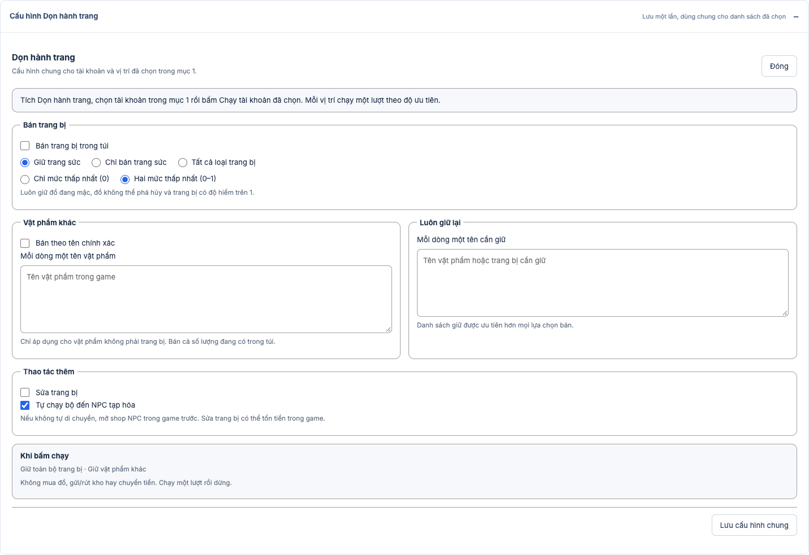

# Dọn hành trang theo tài khoản đã chọn

Dọn hành trang nằm trong **2. Nhiệm vụ và ưu tiên**. Cấu hình chung một lần, chọn tài khoản và vị trí ở mục 1 rồi bấm **Chạy tài khoản đã chọn**. App đăng nhập và dọn lần lượt các ô đã chọn, giống các nhiệm vụ khác. Không cần tự đăng nhập từng nhân vật trước.

1. Bấm **Cài đặt** của **Dọn hành trang** và chọn việc cần làm. Mặc định giữ toàn bộ đồ, không sửa trang bị và không bật nhiệm vụ.
2. Nếu bán trang bị, chọn nhóm: giữ trang sức, chỉ bán trang sức, hoặc tất cả loại trang bị. Hai mức độ hiếm được hỗ trợ là mức thấp nhất (0) và hai mức thấp nhất (0–1).
3. Nhập **tên cần giữ**, mỗi dòng một tên. Danh sách giữ được ưu tiên. Vật phẩm ngoài trang bị chỉ bán khi nhập đúng tên; sẽ bán cả số lượng trong túi.
4. Mặc định tự chạy bộ đến NPC tạp hóa. Có thể tắt nếu shop đã được mở sẵn. Không dùng phù, xa phu hoặc dịch chuyển trả phí. Sửa trang bị có thể tốn tiền trong game.
5. **Lưu cấu hình chung** chỉ lưu, chưa chạy. Tích Dọn hành trang và đặt ưu tiên; số nhỏ chạy trước. Chọn tài khoản/ô ở mục 1 rồi bấm Chạy. Nếu có bán đồ, app hỏi xác nhận một lần trước khi khởi động hàng đợi.

Mỗi ô chạy một lượt rồi chuyển sang việc hoặc nhân vật tiếp theo. Khi dừng và chủ động bấm Chạy lượt mới, các ô đã chọn được phép dọn lại; hàng đợi đang chạy không tự lặp bán liên tục. Một lượt có giới hạn 180 giây. Không áp điều kiện cấp 40 của Boss lên Dọn hành trang.

## Giữ đồ và phạm vi hỗ trợ

Đồ đang mặc, đồ không thể phá hủy và trang bị có độ hiếm trên 1 được bảo vệ bởi routine. Giữ trang sức dùng ba mã loại đã kiểm chứng 6, 7, 8; không tự đặt tên loại vũ khí/áo/giày từ enum chưa rõ. Tên bán và giữ đối chiếu chính xác; danh sách tên cần giữ thắng danh sách bán.

Cấu hình hàng đợi chỉ cho phép bán/giữ/sửa đồ và chạy bộ. Không lấy cài đặt mua thuốc, gửi/rút kho hay chuyển tiền từ Luyện công hoặc Dã Tẩu. Chưa có trường giới tính hoặc thao tác vứt đồ được xác minh, và chưa có dry-run trả danh sách chính xác sẽ bán. Panel tóm tắt cấu hình, không giả làm bản xem trước hành trang.

Ảnh minh họa dùng dữ liệu thử, không phải kết quả bán đồ thật.

